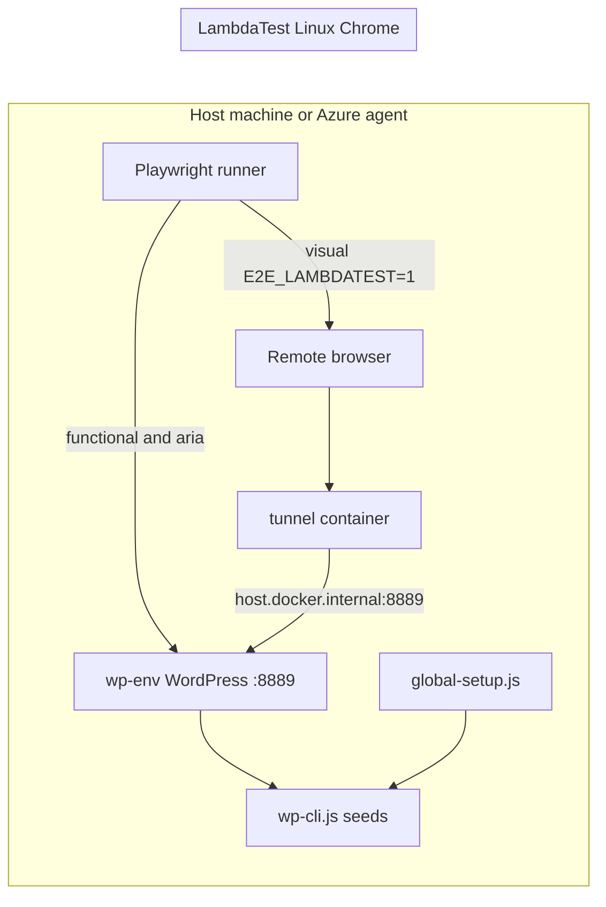
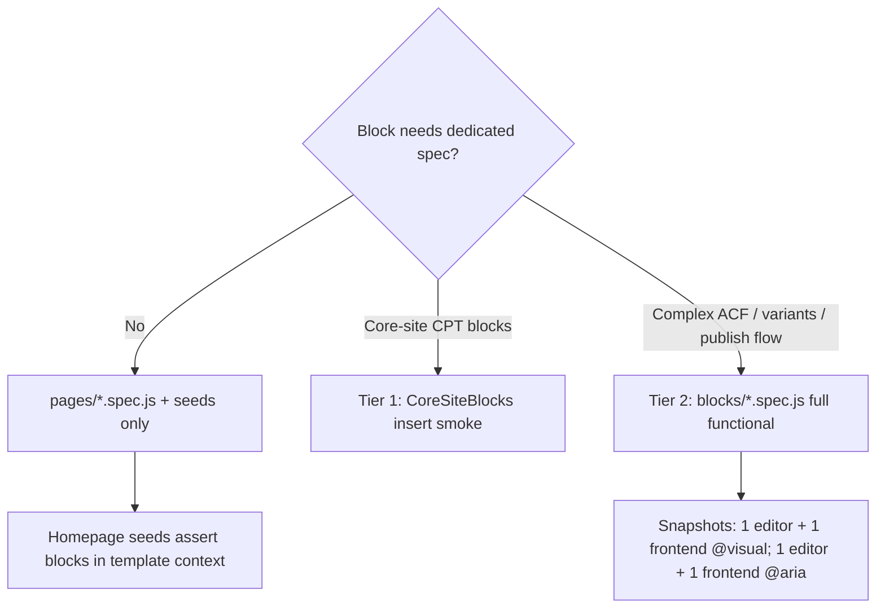

# Agent guide: `tests/` (Playwright e2e)

**Audience:** Cursor and other coding agents maintaining or extending this theme’s automated tests.

**Human-oriented runbook:** [`readme.md`](../readme.md) (install, npm scripts, LambdaTest tunnel). This file captures **why** the stack is shaped the way it is and **how to change it safely**.

---

All automated tests live under **`tests/e2e/**`**: Playwright + wp-env Docker WordPress + `@wordpress/scripts` / `@wordpress/e2e-test-utils-playwright`. PHP seed **fixtures** live under `tests/fixtures/` and run via `wp-env run cli wp eval-file`.

---

## High-level architecture



1. **WordPress** runs in **wp-env** (generated `.wp-env.e2e.json`) as a **subdirectory multisite** on port **8889**.
2. **Functional** and **`@aria`** tests use **host** Chrome locally (`channel: 'chrome'`) or Chromium in CI.
3. **`@visual`** tests use **LambdaTest** Linux Chrome (`E2E_LAMBDATEST=1`) for PNG baselines.
4. **Admin auth** for wp-scripts setup uses **127.0.0.1**; LambdaTest runs get a **second** storage state logged in via **host.docker.internal**.
5. **Front-end admin bar** is hidden via `show_admin_bar` in the e2e mu-plugin so public screenshots and `@aria` body snapshots match a visitor; the block editor still shows the toolbar in wp-admin. The same mu-plugin dequeues `bc-sitka-spruce-a11y-warnings` on the public site so editor-only dashed alt borders do not appear in `@visual` runs that reuse admin cookies.

---

## Directory layout (`tests/e2e`)

| Path | Role |
|------|------|
| `blocks/*.spec.js` | Optional **tier 1–2** block specs (see [Block testing tiers](#block-testing-tiers)); not every theme block gets a file |
| `pages/*.spec.js` | Page integration specs (composed templates, section order, interactions) |
| `layout/*.spec.js` | Theme chrome (header/footer) |
| `fixtures/test.js` | Extends `@wordpress/e2e-test-utils-playwright` `test` / `expect` — **import from here** |
| `helpers/` | Shared flows (`editor.js`, `header.js`, `e2e-env.js`, `lambdatest.js`, `wp-cli.js`, `viewports.js`) |
| `scripts/` | wp-env boot (`start-wp-env-e2e.mjs`, `generate-wp-env-e2e.mjs`), plugin resolve (`resolve-plugin.mjs`), tunnel (`lambdatest-tunnel.mjs`) |
| `mu-plugins/e2e-seed-endpoint.php` | LambdaTest URL rewriting, block allowlist, e2e-only ACF `pathways` / `focus_areas` ID→`WP_Post` normalization for core program reads |
| `plugins.json` | Committed plugin catalog |
| `themes.json` | Bellevue 2022 main-site theme release zip (resolved like plugins) |
| `**/__snapshots__/` | PNG and YAML baselines next to specs |

Config: repo root [`playwright.config.js`](../playwright.config.js).

---

## Block testing tiers

Most blocks are covered by **seeded page templates** (`pages/*.spec.js`) and the mu-plugin allowlist—not by a dedicated `blocks/*.spec.js`. Use three tiers so the suite does not grow into a per-block Nightwatch-style matrix.



| Tier | Spec | Snapshots | Functional |
|------|------|-----------|------------|
| **0 — Composition** | None; block appears in seeded [`pages/*.spec.js`](e2e/pages/) | Page-level `@aria` / sectional `@visual` only | Template smoke in page specs |
| **1 — Editor smoke** | [`CoreSiteBlocks.spec.js`](e2e/blocks/CoreSiteBlocks.spec.js) | None | Insert + visible in canvas |
| **2 — Block contract** | e.g. [`PostsFeature.spec.js`](e2e/blocks/PostsFeature.spec.js), [`AnnouncementBanner.spec.js`](e2e/blocks/AnnouncementBanner.spec.js) | 2× `@visual`, 2× `@aria` (desktop via `skipDuplicateBlockViewport`) | Insert, publish→frontend, variant DOM/behavior, axe where variants differ |

### When to add `blocks/<Block>.spec.js`

Add or extend a block spec only when **at least two** are true:

1. ACF or repeater fields with **meaningful variants** (button vs links, optional media, etc.).
2. **Publish → frontend** behavior is not fully exercised by any seeded page template.
3. **Data dependencies** (uploads, CPT queries, main-site switch) need isolated setup.
4. Regressions are **high impact** or historically flaky in editor save/render.

Otherwise rely on **tier 0** (page integration + seeds) and/or **tier 1** (`CoreSiteBlocks`).

**Non-goals:** Do not add block specs for every Mayflower block; do not duplicate page-level layout confidence in block PNGs.

### Standard block spec shape (tier 2)

- `prepareEditorPage` + `skipDuplicateBlockViewport` in `beforeEach`.
- Functional tests per variant that matter—**no snapshot required per variant**.
- **At most** one canonical variant for `@visual` and `@aria` (editor + frontend each).
- Editor `@aria` for blocks using [`Link`](../src/blocks/shared-elements/link.js): deselect the block before `toMatchAriaSnapshot` so selection-only **Edit Link** / **Add Link** controls are not in the tree (see [`PostsFeature.spec.js`](e2e/blocks/PostsFeature.spec.js)).
- Committed PNG baselines **only** via LambdaTest (`npm run test:e2e:visual:update`).

### Relationship to page tests

Block specs own **field variants and publish contract** (href/target, repeaters, optional media). Page specs own **template composition** (section order, chrome, multisite context). Example: Announcement Banner appears in division/department/support homepage `@aria` YAML; [`AnnouncementBanner.spec.js`](e2e/blocks/AnnouncementBanner.spec.js) covers ACF variants and axe without mirroring every homepage layout.

### Section adjacency (CSS transitions)

Canonical home for **section background / arch / divider** regressions is [`SectionAdjacency.spec.js`](e2e/pages/SectionAdjacency.spec.js), seeded by [`e2e-section-adjacency.php`](../fixtures/e2e-section-adjacency.php) onto the **E2E Section Adjacency** no-sidebar page (`sectionAdjacencyPageUrl`).

- Scenarios are **CSS-rule pairs** from [`src/scss/components/_section.scss`](../src/scss/components/_section.scss) (white divider hide, same-color borders, arch overlap/suppression, curved stacks, announcement margin/inset)—not a full Chromatic-style color matrix.
- One **representative block per section signature** (body, listing, contact, degrees, tabs, media gallery, differentiator, support-feature, announcement-banner). Blocks that share a signature are covered on homepage/program templates instead of duplicating here.
- Keep [`FlexiblePage.spec.js`](e2e/pages/FlexiblePage.spec.js) focused on template composition (intro, sidebar, WYSIWYG); do not append adjacency stacks to that page.
- **Scenario Group wrappers** (`#e2e-adj-scenario-*`) are an e2e harness for focused locators/screenshots. Use **`align: full`** (theme `block-wrapper.alignfull` — no `make-container()` gutters) and **`layout: { type: default }`** (WP flow layout). Do not omit either attribute.
- **Separators between scenario groups** (`e2e_adjacency_scenario_separator()`) intentionally break cross-scenario adjacency on the megapage so full-page visuals do not mix neighboring cases. Do not remove them when tweaking seeds.
- **Sticky-header screenshot pitfall:** `#header-wrapper` is `position: sticky`. Playwright stitches tall element screenshots by scrolling, which re-paints the header mid-capture. Use [`prepareAdjacencyScreenshot()`](e2e/helpers/page-integration.js) and screenshot **per-scenario** wrappers (`#e2e-adj-scenario-*`), never one megapage locator for element shots.
- **Viewport budget:** Per-scenario `@visual` PNGs are **desktop-only** (`@desktop-only`, so tablet/mobile projects never schedule them). Full-page `section-adjacency-full.png` runs on **desktop, tablet, and mobile** via [`expectFullPageScreenshot()`](e2e/helpers/page-integration.js) (lazy-load scroll + image settle + 60s stability timeout) so breakpoint overview is covered without 12×3 scenario baselines. LambdaTest remote captures often exceed Playwright’s default 5s “two consecutive stable screenshots” window on long pages.

---

## Design decisions (preserve unless intentionally changing product/infra)

### Playwright CLI vs `wp-scripts test-playwright`

- **Use:** `wp-scripts test-playwright` via `npm run test:e2e:*`.
- **Why:** This is the wp-scripts test entry. `package.json` sets `PLAYWRIGHT_SKIP_BROWSER_DOWNLOAD=1` so the wrapper does not install browsers on every run, and sets `WP_BASE_URL` to the department subsite before wp-scripts can default to `http://localhost:8889`.

### wp-env port **8889** and subsite **`/e2e-dept/`**

- Chain: `tests/e2e/helpers/e2e-env.js` → `playwright.config.js` (default `WP_BASE_URL`) → `BC_SITKA_E2E_WP_PORT` in the mu-plugin.
- **Playwright `WP_BASE_URL` defaults to** `http://127.0.0.1:8889/e2e-dept` (Sitka department subsite). WP-CLI seeds use `--url` on the subsite unless seeding the main-site core CPTs.
- **Changing the port or subsite slug requires updating all of the above.**
- **PHP (wp-env container)** is **`8.5`** (`E2E_WP_ENV_PHP_VERSION` in [`e2e-env.js`](e2e/helpers/e2e-env.js), written into `.wp-env.e2e.json`). **Azure hosted-agent PHP** for Composer in `build-base` is **`8.3`** (agents do not register `php8.5` yet). After changing wp-env PHP, run `npm run env:e2e:destroy` then `npm run env:e2e:start`.

### Multisite topology (e2e)

| Site | URL | Role |
|------|-----|------|
| Main (blog 1) | `http://127.0.0.1:8889` | **Bellevue 2022** theme (release zip or local checkout via [`themes.json`](e2e/themes.json)) + Bellevue 2022 CPT plugins + [`seed-e2e-core-site.php`](../fixtures/seed-e2e-core-site.php) (organization, news, programs, pathways, etc.). ACF field groups load from Bellevue `acf-json/`. |
| Department subsite | `http://127.0.0.1:8889/e2e-dept` | **Sitka** theme + Sitka readme plugins (breadcrumb, Mayflower, OHO Views, ACF, plus e2e-only TablePress and Trustees Agenda) + [`seed-e2e-integration.php`](../fixtures/seed-e2e-integration.php). |

Core CPT plugins (`bellevue-2022-organization`, `news`, `program`, `pathway`, `components`) are **activated on the main site only**. Sitka registers `program` itself and reads the other core types from the main site, so those plugins stay inactive on the department subsite.

After switching from single-site e2e to multisite, or after changing main-site theme mappings / Bellevue checkout, run `npm run env:e2e:start`. Every start runs `wp-env reset` and then the full after-start list, so fixture and theme activation changes replace the previous database. Use `npm run env:e2e:destroy` only when the Docker image or plugin catalog itself must be rebuilt.

**Bellevue 2022 theme for main site:** [`themes.json`](e2e/themes.json) lists the GitHub release zip (same `GITHUB_PAT` download path as [`plugins.json`](e2e/plugins.json)). [`generate-wp-env-e2e.mjs`](e2e/scripts/generate-wp-env-e2e.mjs) resolves and maps `wp-content/themes/bellevue-2022`. Local dev may use `themes.local.json` (see [`themes.local.example.json`](e2e/themes.local.example.json)), `BELLEVUE_2022_THEME_PATH`, or a sibling `../bellevue-2022` checkout. CI sets `E2E_STRICT_PLUGINS=1` and downloads the catalog zip only.

After `env:e2e:start`, run `npm run env:e2e:verify` to confirm main-site theme/CPT/ACF and subsite program smoke checks (see [`verify-e2e-stack.mjs`](e2e/scripts/verify-e2e-stack.mjs)).

### E2e vs production (accepted deltas)

Production department multisite is the target behavior; wp-env intentionally differs in a few places. **Do not change theme production PHP** to match these unless the same defect is reproduced on staging.

| Behavior | Production expectation | E2e shim / difference | Remove shim when |
|----------|------------------------|------------------------|------------------|
| Program `pathways` / `focus_areas` ACF shape on main | `WP_Post` objects after normal admin saves | [`e2e-seed-endpoint.php`](e2e/mu-plugins/e2e-seed-endpoint.php) `acf/load_value` normalizes IDs → posts | Staging multisite reproduces ID-only values and product agrees on a shared fix |
| Main-site ACF repeaters (e.g. `links`, `services_resources`) | Formatted row arrays | Mu-plugin `acf/load_value/type=repeater` rebuilds rows when ACF returns a row-count string | Same as pathways |
| Core CPT `image` ACF field | Theme expects array with `id` | Mu-plugin `acf/format_value/name=image` reshapes attachment ID | Same as above |
| Differentiator ACF (icon field) | Bellevue `acf-json` + Font Awesome field type | [`e2e-differentiator-acf.php`](../fixtures/e2e-differentiator-acf.php) registers a text icon field on main | Font Awesome ACF plugin added to main-only catalog |
| Theme block registration | All `bc-sitka-spruce/*` blocks | Mu-plugin allowlist unregisters unused blocks (LambdaTest editor perf) | Never on production; expand allowlist when seeds need a block |
| Public frontend | Visitor (no admin bar) | `show_admin_bar` false; dequeue a11y-warnings script on frontend | N/A (test-only) |
| LambdaTest / tunnel URLs | Real hostnames | Mu-plugin + tunnel proxy rewrite `127.0.0.1` ↔ `host.docker.internal` | N/A (test-only) |
| Subsite plugins | Sitka readme stack | **E2e-only:** TablePress, Trustees Agenda (governance seeds) | Only if production dept sites adopt the same plugins |
| Main-site plugins | Full college stack | **Subset:** Bellevue CPT plugins in [`plugins.json`](e2e/plugins.json) only on main | Add plugins when a seed or verify step proves a missing CPT |
| Pathway permalinks from dept subsite | Main-site `bellevue-2022-pathway` registers `pathway` | Mu-plugin registers `pathway` with slug `academics/bc-pathways` when the CPT is missing on the request | Dept subsite loads the same pathway plugin as production, or core fixes multisite `get_permalink` after `switch_to_blog` |
| News permalinks from dept subsite | Main-site `bellevue-2022-news` registers `news` (`news/article`) | Mu-plugin registers `news` with slug `news/article` when missing; core seed sets stable `post_name` on four E2E stories | Same as pathway |
| Footer copyright year | `date( 'Y' )` in theme | Mu-plugin `timber/context` sets `current_year` to **2026** | Never on production; bump constant when refreshing aria snapshots after a year change |

Functional page specs may run with **admin cookies** (Playwright storage state for editor tests). The mu-plugin hides the admin bar on the frontend; `@aria` body trees may still include `logged-in` on `body`—that is expected for this suite.

### Catalog bump checklist

When bumping release URLs in [`plugins.json`](e2e/plugins.json) or [`themes.json`](e2e/themes.json):

1. Prefer bumping **Bellevue plugin zip set and theme zip** in the same PR when they ship together.
2. `npm run env:e2e:start` so `wp-env reset` reinstalls WordPress and after-start reseeds core content.
3. Run `npm run env:e2e:verify`.
4. Run `npm run test:e2e:functional -- tests/e2e/pages/SingleProgram.spec.js tests/e2e/pages/DepartmentHomepage.spec.js`.
5. Grep `field_` under `tests/fixtures/` for ACF key drift after Bellevue `acf-json` changes.
6. Note versions in the PR; refresh `@visual` PNGs on LambdaTest only when UI actually changed.

### webServer readiness

Playwright runs `start-wp-env-e2e.mjs` and waits for the log line `WP_ENV_E2E_READY_LOG` in [`e2e-env.js`](e2e/helpers/e2e-env.js) (`webServer.wait.stdout`). The start script reuses running containers, then always runs `wp-env reset` and the full after-start seed. `reuseExistingServer: !CI` and `E2E_WPENV_RUNNING=1` attach to an already-running wp-env. `E2E_WPENV_RUNNING` skips Playwright's `webServer` because `npm run env:e2e:start` already booted WordPress. Azure runs `env:e2e:start` before the functional suite and `env:e2e:reseed` (idempotent after-start, no `wp-env reset`) before the visual suite.

### Host URL: **127.0.0.1**, not `localhost`

Avoids macOS IPv6/`::1` mismatches between Playwright and wp-env.

### LambdaTest base URL: **host.docker.internal**

- Remote browsers use `http://host.docker.internal:8889/e2e-dept` (`getLambdaTestPlaygroundBaseUrl()`).
- Host-side WP-CLI and wp-scripts login stay on **127.0.0.1**.
- Mu-plugin rewrites asset URLs when `HTTP_HOST` is `host.docker.internal`.

### Block registration allowlist

The mu-plugin unregisters every `bc-sitka-spruce/*` block **not** listed in `BC_SITKA_E2E_ALLOWED_THEME_BLOCKS` ([`e2e-seed-endpoint.php`](e2e/mu-plugins/e2e-seed-endpoint.php)). The list covers blocks used by integration seeds and editor specs (homepages, flexible page, tabs, cards, etc.), not only block-focused specs. Loading every block’s `editorScript` through the tunnel slows LambdaTest editor screenshots. **Add the block name when seeds or a new spec need that block on the frontend or in the editor.**

To check allowlist drift: `rg -o "bc-sitka-spruce/[a-z0-9-]+" tests/fixtures | sort -u` and compare to `BC_SITKA_E2E_ALLOWED_THEME_BLOCKS` in the mu-plugin.

### Bellevue 2022 / core-site blocks

These blocks read main-site CPTs via `switch_to_blog()` / `network_site_url()` REST. **Tier 0** frontend coverage lives in `pages/*.spec.js` after [`seed-e2e-core-site.php`](../fixtures/seed-e2e-core-site.php) + [`e2e-core-content-helpers.php`](../fixtures/e2e-core-content-helpers.php). **Tier 1** editor insert/load is in [`CoreSiteBlocks.spec.js`](e2e/blocks/CoreSiteBlocks.spec.js)—no dedicated tier-2 block spec unless the checklist above applies.

### Page integration seeds

- [`tests/fixtures/seed-e2e-core-site.php`](../fixtures/seed-e2e-core-site.php) — main-site CPTs (`seedCoreSiteData()` / wp-env `afterStart`).
- [`tests/fixtures/seed-e2e-integration.php`](../fixtures/seed-e2e-integration.php) — subsite pages/CPTs for `pages/*.spec.js` (via `seedIntegrationData()` in `wp-cli.js`, which ensures core seed first).
- [`tests/fixtures/e2e-homepage-variant.php`](../fixtures/e2e-homepage-variant.php) — sets `site_type` and static front page per homepage spec.
- [`tests/fixtures/seed-chrome-variants.php`](../fixtures/seed-chrome-variants.php) — ACF chrome states for extended header/footer tests.
- [`seed-site-chrome.php`](../fixtures/seed-site-chrome.php) also seeds **`degree_sock`** site options so `single-program.php` renders the degree sock instead of the unconfigured error state.

### Seeding: WP-CLI via wp-env

- `tests/e2e/helpers/wp-cli.js` runs `wp-env run --config=.wp-env.e2e.json cli wp eval-file …`.
- Seed helpers cache results per process; do not seed in `beforeEach`.
- When the database already has `bc_sitka_e2e_core_seed` / `bc_sitka_e2e_integration_seed`, Playwright helpers **read cached maps** instead of re-running heavy seed PHP inside one test process. `env:e2e:start` resets that database first, so the next run loads the current fixtures.
- `global-setup.js` calls `warmE2eSeedCachesFromDatabase()` when `E2E_WPENV_RUNNING=1` so runs against an already-started wp-env avoid redundant CLI work before the first spec file.

### Plugin resolution

- **Catalog:** `tests/e2e/plugins.json` — remote URLs, `envPathVar`, `plugins.local.json` overlay. Main-site Bellevue theme: `tests/e2e/themes.json` + optional `themes.local.json`.
- **Generated config:** `npm run env:e2e:generate` writes `.wp-env.e2e.json` (gitignored).

### Workers = **1**

One WordPress database; parallel workers race on posts and editor state.

### Viewport projects and `@visual` budget

- `desktop` runs the functional suite except `@narrow-only`; **tablet** and **mobile** projects use Playwright `grep: /@viewport|@visual/` and `grepInvert: /@desktop-only/` so narrow viewports run breakpoint-specific functional tests plus `@visual` screenshots that are not desktop-only.
- Tag breakpoint-only functional tests with **`@viewport`** (application-guide accordion step, header offcanvas/submenu/CTA). Add **`@narrow-only`** when the test must not run on desktop (tabcordion accordion). Do not tag desktop-only tab tests, axe, `@aria`, or generic layout assertions.
- Tag snapshots that must not run on tablet/mobile with **`@desktop-only`** (section-adjacency scenarios, block-editor `@visual`). `skipDuplicateBlockViewport` still skips block-editor `@aria` on narrow viewports when those tests are scheduled. `@aria` stays desktop-only via the narrow project grep.
- **`@visual` is only for tests that call `toHaveScreenshot`.** Attribute or DOM assertions belong in functional tests (host), not LambdaTest.

### wp-env runtime (speed)

- Generated `.wp-env.e2e.json` sets `SCRIPT_DEBUG: false` and `DISABLE_WP_CRON: true` (debug logging stays on). After changing these constants, restart wp-env; refresh committed PNG baselines on LambdaTest if frontend assets shift (`npm run test:e2e:visual:update`).
- First `wp-env start` after plugin/config changes can take several minutes; host after-start seeding (`run-wp-env-after-start.mjs` from `start-wp-env-e2e.mjs`) runs multisite + fixture setup after containers are up (not wp-env `lifecycleScripts`, which nested `wp-env run` and broke on macOS/Windows).
- On CI, `start-wp-env-e2e.mjs` pre-pulls `mariadb:lts` and retries `wp-env start` when Docker Hub is slow; Azure also sets `retryCountOnTaskFailure` on the start step.

### Block frontend fixtures (no editor boot)

- Tier-2 block specs publish frontend pages once via [`seedBlockFrontendPages()`](e2e/helpers/wp-cli.js) and [`seed-e2e-block-frontend-pages.php`](../fixtures/seed-e2e-block-frontend-pages.php) (request payload in gitignored `tests/fixtures/.e2e-block-seed-request.json`). Frontend, `@aria`, axe, and frontend `@visual` tests `goto` those URLs; editor describes still use `prepareEditorPage()`.

### Test tags

| Tag | Runner | Snapshots |
|-----|--------|-----------|
| (none) | Functional on host (desktop: all; tablet/mobile: none unless combined with `@viewport`) | — |
| `@viewport` | Functional on tablet/mobile (and desktop, unless also `@narrow-only`) | — |
| `@narrow-only` | Excluded from the desktop project (`grepInvert`); still needs `@viewport` to run on tablet/mobile | — |
| `@aria` | Host (desktop project) | `*.yml` (`toMatchAriaSnapshot`) |
| `@visual` | LambdaTest | `*.png` (`toHaveScreenshot`) |
| `@desktop-only` | Excluded from tablet/mobile projects (`grepInvert`) | Desktop `@visual` only |

`@aria` YAML baselines are normalized to **LF** in Git ([`.gitattributes`](../.gitattributes)). Playwright compares file bytes, not just tree semantics—CRLF on Windows checkouts causes opaque failures. See [readme Troubleshooting — `@aria` line endings](../readme.md).

### LambdaTest tunnel

- Local default tunnel / container name is **`e2e-tunnel-dev`**; auto-start in `global-setup.js` unless `E2E_LAMBDATEST_TUNNEL_AUTO=0`.
- CI sets a unique `E2E_LAMBDATEST_TUNNEL_NAME` (`e2e-tunnel-ado-$(Build.BuildId)`) on start, visual, and stop so parallel jobs and local tunnels do not collide on the shared LambdaTest account.
- CI starts the tunnel with `npm run tunnel:e2e:start:detached` before functional tests, waits until the tunnel info API responds before visual tests, and sets `E2E_LAMBDATEST_TUNNEL_AUTO=0` for the visual run. Locally, `npm run tunnel:e2e:start` still starts the tunnel and waits.

### Visual testing pipeline (LambdaTest)

| Layer | File | Role |
|--------|------|------|
| Docker tunnel (`e2e-tunnel-dev` / CI `e2e-tunnel-ado-*`) | [`lambdatest.js`](e2e/helpers/lambdatest.js), [`lambdatest-tunnel.mjs`](e2e/scripts/lambdatest-tunnel.mjs) | Remote browsers reach host wp-env via `host.docker.internal:8889` |
| Playwright `connect` | `playwright.config.js` when `E2E_LAMBDATEST=1` | Linux Chrome on LambdaTest |
| Request proxy | [`lambdatest-tunnel-proxy.js`](e2e/helpers/lambdatest-tunnel-proxy.js) | Routes remote requests to loopback wp-env when the tunnel path is flaky; stubs editor taxonomy prefetch 403s and maps root favicon requests |
| URL rewrite + allowlist | [`e2e-seed-endpoint.php`](e2e/mu-plugins/e2e-seed-endpoint.php) | `X-E2E-Public-Origin`, asset URLs, canonical-redirect guard, block allowlist, classic meta-box loader removed, front-end admin bar off, a11y-warnings script dequeued on frontend |
| Admin cookies | [`global-setup.js`](e2e/global-setup.js) | Host login, then remap storage state for tunnel host |
| Navigation | [`e2e-navigation.js`](e2e/helpers/e2e-navigation.js) | Rewrite seed permalinks for visual runs |

Each workaround lives in exactly one layer. Fix WordPress-side behavior (URLs, redirects, enqueued scripts) in the mu-plugin; keep the proxy limited to transport issues the browser cannot avoid. Do not duplicate a fix in both places.

The LambdaTest plan is **Web Automation on Desktop — Linux**. Keep capabilities in [`lambdatest.js`](e2e/helpers/lambdatest.js) on Linux + Chrome; Windows/macOS or `pw-chromium` use a different minute pool and fail with `422 Lifetime Minutes Exhausted for desktop-automation`.

Committed **PNG** baselines must be produced on LambdaTest with `npm run test:e2e:visual:update` (locally or in CI, with the tunnel and credentials). That script sets `E2E_ALLOW_VISUAL_BASELINE_UPDATE=1` and `E2E_STRICT_PLUGINS=1`. Start WordPress with `E2E_STRICT_PLUGINS=1` first; the update script does not rebuild a running wp-env. Playwright still refuses a raw `--update-snapshots` on LambdaTest outside CI (see [`guard-visual-baseline-update.mjs`](e2e/scripts/guard-visual-baseline-update.mjs)). Refresh all snapshot types with `npm run test:e2e:update`; after a failing run, `npm run test:e2e:update:last-failed` re-runs only failed snapshot tests.

**Optional ADO baseline refresh:** [`.azuredevops/e2e-visual-baseline-update-steps.yml`](../.azuredevops/e2e-visual-baseline-update-steps.yml) runs `test:e2e:visual:update` and publishes `tests/e2e` as artifact `e2e-visual-baselines` for a follow-up commit.

**Screenshot stability (`stylePath`).** [`playwright.config.js`](../playwright.config.js) applies [`screenshot-stability.css`](e2e/helpers/screenshot-stability.css) **only while** `toHaveScreenshot` runs (not on the live site). Allowed contents:

1. **Scrollbar hiding** — prevents Linux Chrome width flips (`1280` vs `1265`) on full-page captures.
2. **Allowlisted subpixel pins** — currently Announcement Banner image `display: block` (no fixed size; columns are often &lt; 260px) and Posts Feature featured `.aspect-ratio-frame` (CSS `aspect-ratio` instead of padding-bottom `%`). These reduce ±1px locator-height flips without changing production theme CSS.

Do **not** add generic spacing/font/layout overrides or loosen `maxDiffPixelRatio` to hide real regressions. New selectors need a short comment naming the failing snapshot.

**Element vs full-page settle.** Before every **locator** `toHaveScreenshot`, call `await settleLocatorForScreenshot( locator )` after the target is visible. The helper scrolls into view and waits for descendant `` load/decode (`naturalWidth > 0`). Full-page shots must use `expectFullPageScreenshot` only (it settles internally). CSS background images (for example sock texture SVG) are not covered by settle.

**Pinned Chrome.** [`lambdatest.js`](e2e/helpers/lambdatest.js) defaults to a fixed Linux Chrome version (override with `E2E_LAMBDATEST_CHROME_VERSION`). Azure sets the same variable in the visual job. Bump the pin only when intentionally refreshing all PNG baselines; discover the current version with `node tests/e2e/scripts/print-lambdatest-chrome-version.mjs` (tunnel + credentials required).

**Visual failure triage:**

| Symptom | Likely cause | What to do |
|---------|--------------|------------|
| Width oscillating within one assertion | Scrollbar `stylePath` missing/broken | Fix scrollbar rules in [`screenshot-stability.css`](e2e/helpers/screenshot-stability.css); do not loosen ratios |
| Large height drop / washed-out region on element shot | Missing settle; below-fold `` not loaded | Add `settleLocatorForScreenshot`; do not re-baseline a broken capture |
| Stable **±1px** screenshot **size** (Playwright fails before `maxDiffPixelRatio`) | Local env drift, or fractional image/aspect boxes | First reproduce with CI-matched inputs (below). If it still fails, set `E2E_DEBUG_SCREENSHOT_GEOMETRY=1`, then extend the **allowlisted** capture pins in `screenshot-stability.css` (test-only). Do **not** change production theme CSS for screenshot jitter, and do not chase the last run with PNG updates alone |
| Stable width, many pixel diffs | Real layout/content change or stale baseline | Re-run once; if UI is correct on LambdaTest, `npm run test:e2e:visual:update` |

**CI-matched local visual verify (no snapshot write):** after `npm ci`, `npm run build`, and `npm run env:e2e:start:strict` (plus tunnel + `LT_*` / `GITHUB_PAT` / `ACF_DOWNLOAD_URL`):

```bash
npm run test:e2e:visual:match-ci -- tests/e2e/blocks/AnnouncementBanner.spec.js tests/e2e/blocks/PostsFeature.spec.js tests/e2e/layout/HeaderFooter.spec.js
```

Plain `npm run test:e2e:visual` reuses whatever wp-env and `assets/dist/` are already present and can falsely report ±1px dimension mismatches against CI baselines.

### Pull request checklist (e2e / visual)

Human-facing copy lives in [readme.md — Pull request checklist](../readme.md#pull-request-checklist-visual--e2e). Agents: use the checklist below when authoring PR text.

- [ ] **Azure Test stage** (or local `npm run test:e2e:ci` with the tunnel started separately via `tunnel:e2e:start` / `tunnel:e2e:stop`, plus secrets) is green, or the failure is explained and unrelated. Azure also stops wp-env when the job finishes.
- [ ] Any new or changed `tests/e2e/**/__snapshots__/*.png` were produced on **LambdaTest Linux Chrome** (`npm run test:e2e:visual:update`)—not `test:e2e:visual:local`.
- [ ] Baseline updates used **catalog plugin zips** (`E2E_STRICT_PLUGINS=1` when starting wp-env; `test:e2e:visual:update` sets the same flag for the test run). No accidental commits from `plugins.local.json` or `MAYFLOWER_BLOCKS_PATH`-style mounts.
- [ ] PR describes **why** pixels changed (theme, block, plugin version in `plugins.json`, seed content, editor prefs, etc.).
- [ ] Partial PNG updates are intentional; if many unrelated snapshots changed, prefer a dedicated baseline-refresh PR or the [visual baseline update ADO template](../.azuredevops/e2e-visual-baseline-update-steps.yml).
- [ ] Did **not** loosen `maxDiffPixelRatio`. [`screenshot-stability.css`](e2e/helpers/screenshot-stability.css) changes are limited to scrollbar hiding or documented subpixel allowlist pins (not generic layout masks).
- [ ] `@aria` `*.yml` snapshots updated when accessibility tree output changed (`npm run test:e2e:aria:update` for diffs only, or `npm run test:e2e:aria:update:all` to rewrite every aria YAML—Playwright treats bare `--update-snapshots` as **missing** files only, not a full refresh).
- [ ] No `@visual` tag on tests that do not call `toHaveScreenshot`.
- [ ] Plugin catalog / mu-plugin / seed PHP changes: reviewers know to run `env:e2e:start` (database reset and reseed). `npm run env:e2e:destroy` is only for image or catalog-install failures.
- [ ] **Viewport tags** on new or changed Playwright tests: breakpoint-only behavior → `@viewport` (add `@narrow-only` when desktop must not collect the test); desktop-only PNG or editor work → `@desktop-only` (include in the `test.describe` title for editor suites); avoid `testInfo.skip` for viewport gating—use tags so Azure JUnit does not report false skips.
- [ ] After e2e changes, `npm run test:e2e:verify-viewport-tags` passes. After a functional and visual run with `CI=true`, `npm run test:e2e:verify-junit-skips` passes (Governance skips when Trustees Agenda did not seed are allowed).

### LambdaTest Chrome version bump playbook

Human-facing steps: [readme.md — Bumping the pinned LambdaTest Chrome version](../readme.md#bumping-the-pinned-lambdatest-chrome-version).

Bump the pin only when LambdaTest’s default Linux Chrome moves and you are ready to **refresh all PNG baselines** in the same PR (or immediately after).

1. **Discover the session version** (tunnel + `LT_*` credentials):

   ```bash
   npm run tunnel:e2e:start
   node tests/e2e/scripts/print-lambdatest-chrome-version.mjs
   ```

   Note the major.minor segment LambdaTest reports (for example `154.0.6367.60` → pin `154.0`).

2. **Update the pin in three places** (keep them identical):

   | Location | Field |
   |----------|--------|
   | [`tests/e2e/helpers/lambdatest.js`](e2e/helpers/lambdatest.js) | `DEFAULT_LAMBDATEST_CHROME_VERSION` |
   | [`.azuredevops/e2e-test-steps.yml`](../.azuredevops/e2e-test-steps.yml) | `E2E_LAMBDATEST_CHROME_VERSION` on the visual step |
   | [`.azuredevops/e2e-visual-baseline-update-steps.yml`](../.azuredevops/e2e-visual-baseline-update-steps.yml) | same |

3. **Regenerate every `@visual` PNG** on LambdaTest with strict plugins:

   - **CI:** run a pipeline using `e2e-visual-baseline-update-steps.yml`, download artifact `e2e-visual-baselines`, commit `__snapshots__`.
   - **Local:** `npm run env:e2e:start:strict`, tunnel up, then `npm run test:e2e:visual:update` (full suite; expect a large diff).

4. **Verify stability:** run `npm run test:e2e:visual` twice back-to-back (wp-env already running + tunnel); both runs should pass with no snapshot writes.

5. **PR:** use the checklist above; call out Chrome bump + baseline refresh in the summary. Do not merge a pin change without the matching PNG commit.

### Editor preferences seed

`seed-editor-preferences.php` is listed in `idempotentWpCliCommands` in [`.wp-env.e2e.after-start.json`](../.wp-env.e2e.after-start.json) (generated). [`start-wp-env-e2e.mjs`](e2e/scripts/start-wp-env-e2e.mjs) runs those steps on **every** start, even when integration fixtures already exist, so subsite `wp_*_persisted_preferences` stay aligned with CI.

---

## Environment variables (quick reference)

| Variable | Typical value | Meaning |
|----------|----------------|---------|
| `WP_BASE_URL` | `http://127.0.0.1:8889/e2e-dept/` | Override Playwright default (department subsite) |
| `E2E_WPENV_RUNNING` | `1` | Skip Playwright `webServer` because wp-env is already running (`test:e2e:functional` and `test:e2e:visual` set this) |
| `BELLEVUE_2022_THEME_PATH` | optional local checkout | Override Bellevue 2022 theme path (ignored when `E2E_STRICT_PLUGINS=1`) |
| `E2E_STRICT_PLUGINS` | `1` | Ignore `plugins.local.json` and catalog `envPathVar` mounts (CI sets this) |
| `E2E_ALLOW_VISUAL_BASELINE_UPDATE` | `1` | Allow local LambdaTest `--update-snapshots` when not in CI (`test:e2e:visual:update` sets this) |
| `E2E_LAMBDATEST` | `1` | LambdaTest browser + tunnel base URL |
| `E2E_LAMBDATEST_TUNNEL_AUTO` | `0` / unset | `0` = do not auto-start tunnel |
| `E2E_LAMBDATEST_TUNNEL_NAME` | optional / CI `e2e-tunnel-ado-<BuildId>` | Docker + LambdaTest tunnel name (default `e2e-tunnel-dev`) |
| `E2E_LAMBDATEST_PLAYGROUND_URL` | optional | Default `http://host.docker.internal:8889/e2e-dept` |
| `E2E_LAMBDATEST_CHROME_VERSION` | optional | Override pinned LambdaTest Linux Chrome (see `DEFAULT_LAMBDATEST_CHROME_VERSION` in `lambdatest.js`) |
| `E2E_DEBUG` | `1` / unset | Verbose plugin-resolution logs in `resolve-plugin.mjs` |
| `E2E_DEBUG_SCREENSHOT_GEOMETRY` | `1` / unset | Log locator/image boxes before Announcement Banner and Posts Feature frontend `@visual` shots |
| `LT_USERNAME`, `LT_ACCESS_KEY` | secrets | Required for `@visual` |
| `GITHUB_PAT`, `ACF_DOWNLOAD_URL` | CI / local | Private GitHub zips; ACF Pro zip download URL |

---

## CI (Azure DevOps — `azure-pipelines.yml` Test stage)

E2e runs in the shared **theme-ci** **Test** stage (`runTests: true`), which runs **before** **Build**. A failed Test stage skips Build and all **DeployTest_*** Kinsta stages.

**One-time ADO setup:** On the theme CI pipeline in ADO, configure **pipeline variables** `LT_USERNAME`, `LT_ACCESS_KEY`, `GITHUB_PAT` (private GitHub release zips), and `ACF_DOWNLOAD_URL` (ACF Pro license download URL; resolved to a mounted plugin directory). Do not add a root-level `variables:` block in `azure-pipelines.yml` when using `extends`.

**Test job flow** (see [`.azuredevops/e2e-test-steps.yml`](../.azuredevops/e2e-test-steps.yml)):

1. `npm@12`, git URL rewrite for `GITHUB_PAT`, then `build-base` (host PHP **8.3**, Node **26.x**) + `npm run build` + `replacetokens` on `style.css` (Test job rebuilds the theme because wp-env needs a full checkout and `node_modules`, not the pruned Build artifact zip). E2e WordPress runs PHP **8.5** inside wp-env Docker.
2. Playwright Chromium (cached under `$(Pipeline.Workspace)/.playwright-browsers`), then `env:e2e:start`.
3. `tunnel:e2e:start:detached`, then `test:e2e:functional` while the tunnel registers.
4. `env:e2e:reseed`, wait for the tunnel (`lambdatest-tunnel.mjs wait`), then `test:e2e:visual` with `E2E_LAMBDATEST_TUNNEL_AUTO=0` and `E2E_STRICT_PLUGINS=1`.
5. Rank slowest cases from `artifacts/junit/functional-junit.xml` and `visual-junit.xml`. Do not drop or retune tests from that list until a human reviews it.
6. Stop tunnel and `env:e2e:stop` (always); publish JUnit from `artifacts/junit/*.xml`
   (`functional-junit.xml`, `visual-junit.xml`). Viewport tests that do not apply to a project
   are excluded with Playwright `grep` / `grepInvert` (`@desktop-only`, `@narrow-only`), so they
   are not collected and do not lower the Azure pass percentage. Governance `test.skip()` still
   reports a skip when the Trustees Agenda plugin did not seed URLs. JUnit is kept outside
   Playwright's disposable `artifacts/test-results/` directory and is written only when `CI` or
   Azure `TF_BUILD` is set.

**Re-run e2e only:** Queue the CI pipeline manually and run the **Test** stage only.

**Job timeout:** Hosted agents default to 60 minutes for the Test job; watch duration on first full PR run.

---

## Code standards for this repo

Follow workspace **human-readable code** rules. Match neighboring files before adding abstractions.

---

## Agent hygiene

- **Do not** widen block allowlist beyond blocks under active test.
- **Do not** commit `plugins.local.json`, `.wp-env.e2e.json`, or secrets.
- **Do not** tag non-screenshot tests with `@visual`.
- **Do not** commit `@aria` `*.yml` updates from a Windows worktree until snapshot files are LF (see readme Troubleshooting).
- Prefer **one fix in a shared helper** over duplicating URL/tunnel logic in each spec.

---

## File index (frequently touched)

| Concern | File |
|---------|------|
| Playwright projects, webServer, LambdaTest `use` | `playwright.config.js` |
| Element screenshot settle / geometry debug | `tests/e2e/helpers/editor.js` (`settleLocatorForScreenshot`, `logScreenshotGeometry`) |
| Tunnel + WS endpoint | `tests/e2e/helpers/lambdatest.js`
| Port / host URL | `tests/e2e/helpers/e2e-env.js` |
| Publish / editor flows | `tests/e2e/helpers/editor.js` |
| Seed WP-CLI | `tests/e2e/helpers/wp-cli.js` |
| wp-env generate + start | `tests/e2e/scripts/generate-wp-env-e2e.mjs`, `start-wp-env-e2e.mjs` |
| Plugin sources | `tests/e2e/scripts/resolve-plugin.mjs`, `plugins.json` |
| URL filters + blocks | `tests/e2e/mu-plugins/e2e-seed-endpoint.php` |
| npm scripts | `package.json` — run: `test:e2e`, `test:e2e:functional`, `test:e2e:aria`, `test:e2e:visual`; update: `test:e2e:update`, `test:e2e:aria:update`, `test:e2e:aria:update:all` (`--update-snapshots=all`), `test:e2e:visual:update`, `test:e2e:update:last-failed`; `env:e2e:start`, `env:e2e:reseed`, `env:e2e:stop`, `env:e2e:destroy`, `tunnel:e2e:*` |
| ADO e2e steps | `.azuredevops/e2e-test-steps.yml`, `.azuredevops/e2e-visual-baseline-update-steps.yml`, root `azure-pipelines.yml` |
| Visual baseline guard | `tests/e2e/scripts/guard-visual-baseline-update.mjs` |
| Viewport tags and JUnit skip checks | `tests/e2e/scripts/verify-e2e-viewport-tags.mjs`, `verify-e2e-junit-skips.mjs` (`npm run test:e2e:verify-viewport-tags`, `test:e2e:verify-junit-skips`) |
| PR template (e2e checklist) | `.github/pull_request_template.md` (links readme checklist) |
| Chrome version probe | `tests/e2e/scripts/print-lambdatest-chrome-version.mjs` |
